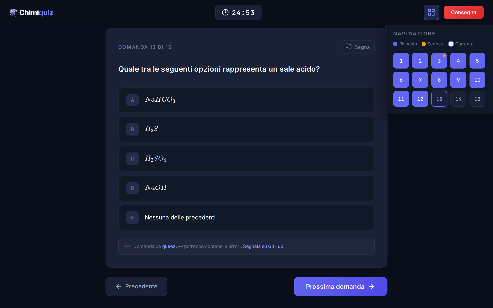
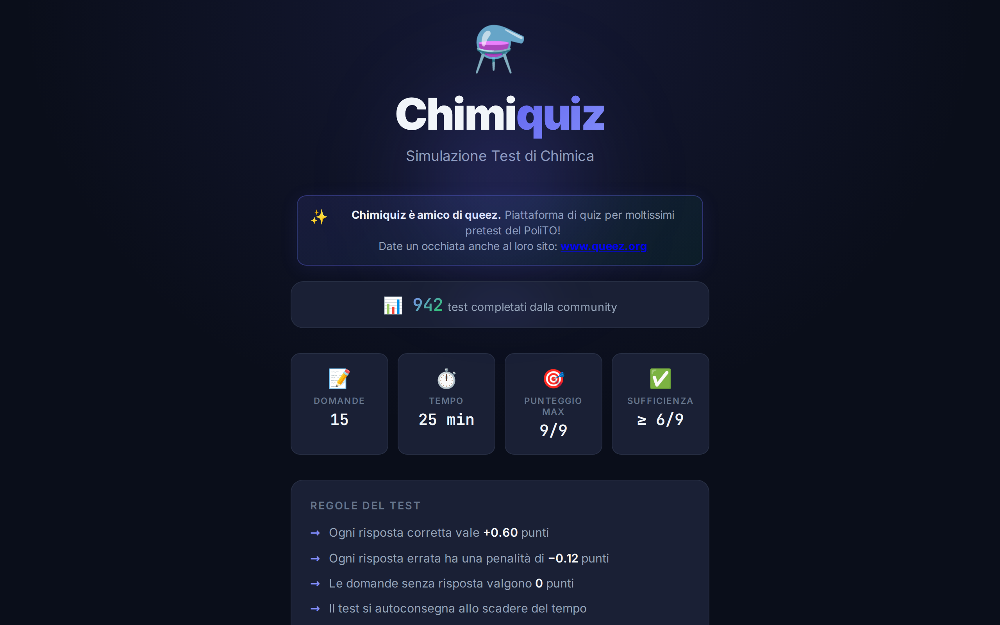
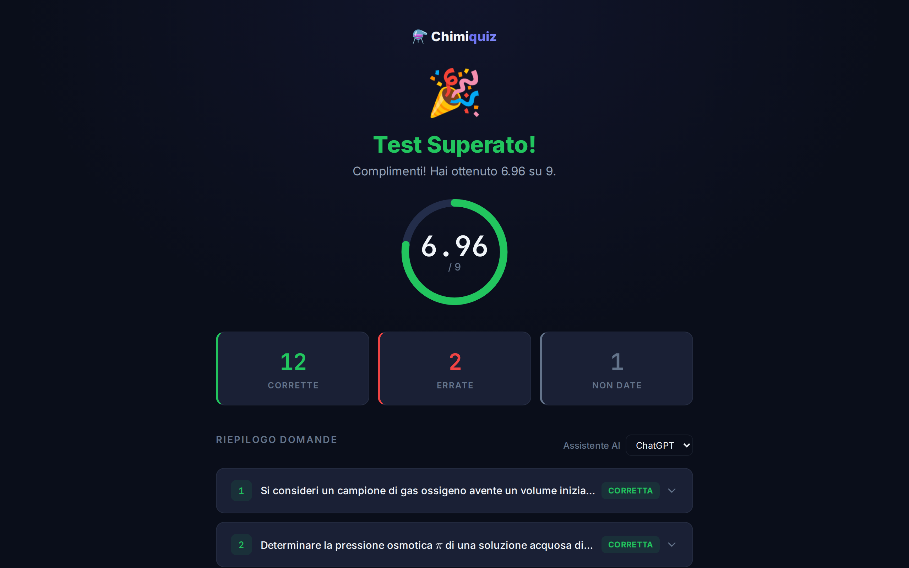

<p align="center">
  
</p>

<h1 align="center">Chimiquiz</h1>

<p align="center">
  Una simulazione del test di Chimica del Politecnico di Torino: 15 domande a risposta multipla, 25 minuti, punteggio su 9.<br>
  Si usa dal browser, senza account e senza installare niente. Le domande arrivano da Poliquiz e da queez.
</p>

<p align="center">
  <a href="https://github.com/SuperTost100/chimiquiz/actions/workflows/ci.yml"></a>
  <a href="LICENSE"></a>
</p>

<p align="center">
  <a href="https://supertost100.github.io/chimiquiz/">Prova il quiz</a> ·
  <a href="#avvio-in-locale">Avvio in locale</a> ·
  <a href="#domande-e-licenza">Domande e licenza</a>
</p>

<p align="center">
  
</p>

## Perché Chimiquiz

Il test di Chimica del Polito ha regole precise: 25 minuti, una penalità per ogni risposta sbagliata, un voto su 9. Chimiquiz le riproduce, così ti alleni nelle stesse condizioni. Le domande sono più di 2.000, quindi un test non somiglia quasi mai al precedente.

Si usa gratis su [supertost100.github.io/chimiquiz](https://supertost100.github.io/chimiquiz/). Non c'è un account e non c'è un server proprio: il sito è una pagina statica, e le domande che hai già visto restano nel browser.

## Cosa fa

1. **Estrae 15 domande.** Evita quelle viste nelle ultime sessioni: ricorda le ultime 256 domande, quindi il ciclo si rinnova dopo circa 17 test. Le domande presenti in entrambi i banchi le toglie `data/global-blacklist.json`.
2. **Cronometra il test.** Il timer parte da 25 minuti e allo scadere il test si consegna da solo. La modalità DSA aggiunge il 30% di tempo (32 minuti e 30 secondi).
3. **Ti lascia muovere tra le domande.** La griglia mostra quali hai risposto, saltato o segnato con la bandierina. Dalla tastiera: frecce per cambiare domanda, da `1` a `5` per scegliere un'opzione, `F` per la bandierina.
4. **Corregge come l'esame.** Ogni risposta giusta vale +0,60, ogni errata -0,12, quelle non date 0. La sufficienza è 6/9, ma da 5,5 in su il test risulta superato perché il voto viene arrotondato.
5. **Ti fa rivedere gli errori.** Il riepilogo mostra ogni domanda con la correzione. Per una spiegazione, apre ChatGPT, Claude o Gemini in una nuova scheda con il prompt già scritto.

Se una domanda è sbagliata, "Cambia domanda" la sostituisce e non te la ripropone più. Le domande di Poliquiz si segnalano su poliquiz.it; quelle di queez. con [questo modulo](https://github.com/SuperTost100/chimiquiz/issues/new?template=domanda-queez.yml) o con una pull request su `data/queez-chimica.json`.

<table>
  <tr>
    <td width="50%"></td>
    <td width="50%"></td>
  </tr>
  <tr>
    <td>La home mostra le regole e quanti test ha completato la community.</td>
    <td>Il risultato con il riepilogo di ogni domanda e la correzione.</td>
  </tr>
</table>

Il sito ha un solo tema, scuro. Per questo gli screenshot sono solo in versione scura.

## Avvio in locale

È un sito statico (`index.html`, `index.css`, `app.js`), senza build. Serve un server qualsiasi, perché il browser non carica i file JSON da `file://`. Serve anche una connessione, perché il sito scarica le domande di Poliquiz da `api.poliquiz.it` e i font da Google Fonts.

```bash
git clone https://github.com/SuperTost100/chimiquiz.git
cd chimiquiz
python3 -m http.server 8000     # poi apri http://localhost:8000
```

Dalla console del browser:

| Comando                        | Cosa fa                                                         |
| ------------------------------ | --------------------------------------------------------------- |
| `chimiquiz.stats()`            | Domande caricate, cronologia recente e domande escluse          |
| `chimiquiz.resetBlacklist()`   | Rimette in gioco le domande che hai escluso                     |
| `chimiquiz.resetRecent()`      | Svuota la cronologia, così tutte le domande tornano disponibili |
| `chimiquiz.setDsa(true/false)` | Attiva o disattiva la modalità DSA                              |

Il sito è pubblicato con GitHub Pages dal branch `main`. Quando esce una versione nuova (`APP_VERSION` in `app.js`), chi ha la pagina aperta vede un banner per ricaricarla.

## Dati e privacy

Cronologia, domande escluse e modalità DSA restano nel `localStorage` del browser. Il sito scarica le domande da `api.poliquiz.it` e conta i test completati con [GoatCounter](https://www.goatcounter.com), che non usa cookie. Il numero di test completati compare in home.

## Domande e licenza

Il codice è sotto [Apache 2.0](LICENSE). Le domande no.

- **Poliquiz.** Restano sul loro server: Chimiquiz le legge dalla [loro API](https://www.poliquiz.it) a ogni apertura e non ne tiene una copia.
- **queez.** Le domande in `data/queez-chimica.json` appartengono a [queez.](https://queez.org). Per riusarle serve il loro consenso, anche se il file sta in questo repository.
